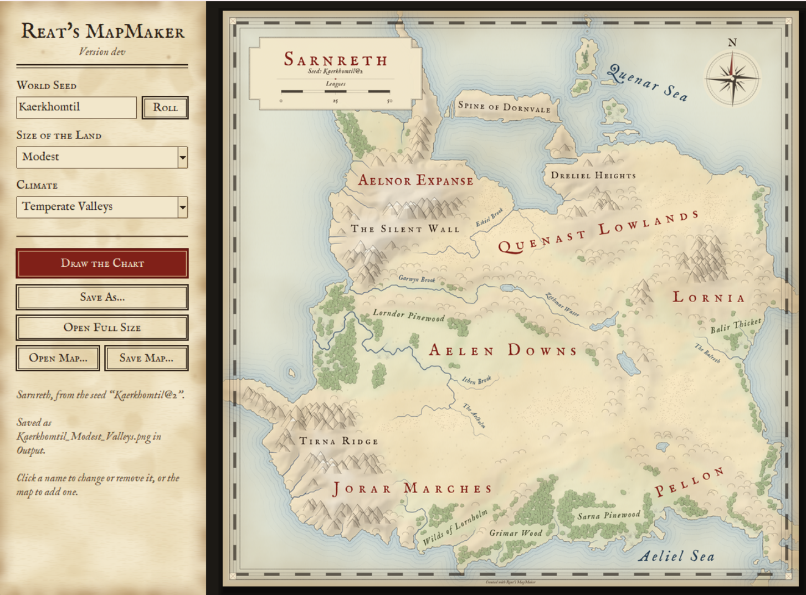

# Reat's MapMaker

This MapMaker is based on the world generation for a game I'm working on. The game grows a whole world from a seed, and before you found your colony you get to see it as an old hand drawn chart. At some point I wanted those charts outside the game too, for sharing seeds, for tabletop sessions, or just because I like looking at them. So I pulled the generator out and put a small window around it.

Every map is generated, nothing is hand placed. The coastlines, mountain ranges, rivers, lakes, forests and all the names come out of the seed. Type in any word or number and you get a world.

This repo only holds the releases. The code lives with the game.

> ### 📸 If you like it, follow me on [Instagram @reatkay](https://www.instagram.com/reatkay/)
> That's where I post new maps, progress on the game and whatever else I'm up to. It really helps!

## Download

Grab the latest `ReatsMapMaker-<version>.exe` from [Releases](../../releases/latest). It's a single file, no installer. Put it in a folder and run it.

It doesn't install anything into Windows, but this is what it writes:

- **`Maps\`** next to the exe: your maps (PNG)
- **`%TEMP%\_MEI…`**: the exe carries its own private copy of Python (with Tk and Pillow), the map generator and the fonts. It unpacks them here when it starts and removes them again when you close it. If it crashes, that folder can stay behind, it's safe to delete
- **`%TEMP%\ReatsMapMaker\`**: working files for the current map (raw image, label data, your edits), overwritten each time. Also safe to delete

### What's inside the exe

For transparency, this is everything that ships inside `ReatsMapMaker-0.1.exe`:

| Part | Version | What it's for | License |
|------|---------|---------------|---------|
| The map generator (`ChartPreview.exe`) | 0.1 | Generates the world and draws the chart, my own C++ code | mine |
| Python runtime | 3.14.3 | Runs the window and the lettering | PSF License |
| Tcl/Tk (tkinter) | 8.6 | The window itself | Tcl/Tk License (BSD style) |
| Pillow | 12.2.0 | Sets the letters on the map and writes the PNGs | MIT-CMU |
| PyInstaller bootloader | 6.22.3 | The small starter that unpacks everything and launches it | GPL 2 with an exception that allows bundling |
| IM Fell English (Roman, Italic, SC) | | The typeface on the charts | SIL Open Font License, included |

That's all. No telemetry, no updater, nothing that talks to the internet.

It does not install Python on your system, doesn't touch a Python you already have, and doesn't download anything. No registry entries, no admin rights, no Start menu entry. The fonts are only loaded for the app itself, they don't get installed either.

## What it does

- Generates a world from any seed, in four sizes and five climates
- Draws it as a chart: parchment, ink, hill and forest glyphs, a compass rose, a title panel with the scale bar
- Names everything in the style of the chart, regions in red spaced capitals, waters in blue italics and so on
- Lets you edit the names afterwards. Click a name to rename or remove it, drag it somewhere else, or click on open map to add your own in one of the existing styles
- Saves every map as a PNG that remembers its seed and all your edits, so you can open it later and keep working on it. You can also save a small `.reatmap` file if you prefer that

## Map sizes and scale

Scales for maps are what my game uses right now. One map tile is 4 km, and the scale bar on the chart is in leagues (about 4.83 km each).

| Size   | Across     |
|--------|------------|
| Small  | ~770 km    |
| Modest | ~1280 km   |
| Large  | ~2050 km   |
| Vast   | ~3070 km   |

If the game changes its scale later, that will come in as a new creation version (see below), so old seeds won't suddenly change.

## Seeds and creation versions

This part is important to me. A seed should always give you the same map, also years from now. But I will keep improving the generator, and every improvement would change what an old seed looks like.

So every seed carries the version of the algorithms that created it. You see it on the chart right after the seed, like `Kaerkhomtil@2`. The number after the `@` is the creation version.

- Type a seed without a version and you get the newest algorithms
- Type it with a version, like `Kaerkhomtil@1`, and you get exactly the map that version made
- Old versions are never removed. If I change something that alters an existing map, it becomes a new version and the old path stays in the code

So if someone shares a seed with you, take the whole thing including the `@` part and you will get the very same map they had.

Currently there are two creation versions:

- **1** the first one
- **2** hill shading fades out behind the names, so the letters don't sit on a blurry smear of mountains anymore

## Requirements

- Windows 10 or 11, 64 bit
- Nothing else, everything it needs is inside the exe
- Bigger worlds take longer to generate, so give a Vast one a moment

## Built with

- **C++** for the world generator and the chart renderer. It's the exact same code the game runs, compiled without the engine
- **Python** with Tkinter for the window and Pillow for setting the lettering and writing the PNGs
- Packaged into one exe with PyInstaller. That only runs on my machine when I build a release, you don't need it
- The typeface is IM Fell by Igino Marini, under the SIL Open Font License, which is included

## Current limitations

- Windows only for now. It does run on Linux, but I don't publish that build yet
- Every name edit redraws the whole map, so it takes about as long as generating it. I want to make that faster
- Names you add yourself are always set level. They don't curve along a river or a mountain ridge like the generated ones do
- No undo yet. If you remove a name by accident, the easiest way back is opening the PNG from before or drawing the chart again
- "Draw the Chart" starts fresh and overwrites the auto saved PNG of that seed. Use "Save As" or "Save Map" if you want to keep your edits seperately
- Only the PNGs this tool saves can be reopened for editing. Once you crop or recompress the image somewhere else, the saved edits are gone
- Some antivirus programs get nervous about single file exes made with PyInstaller. It's a false alarm, but I can't do much about it except sign the exe someday

## Using the maps

Do whatever you like with the maps you make, for your games, your stories, your table. A small "Created with Reat's MapMaker" line sits under the frame, I'd be happy if you leave it there. And if you made it all the way down here, you're definitly someone who should follow me on [Instagram](https://www.instagram.com/reatkay/) 😄
